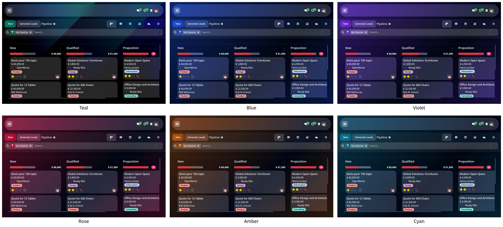
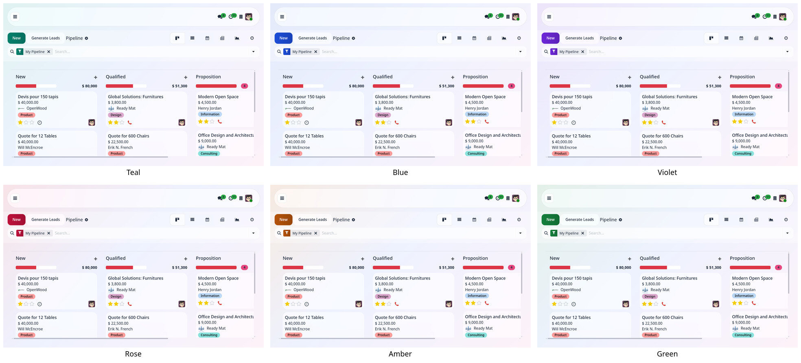
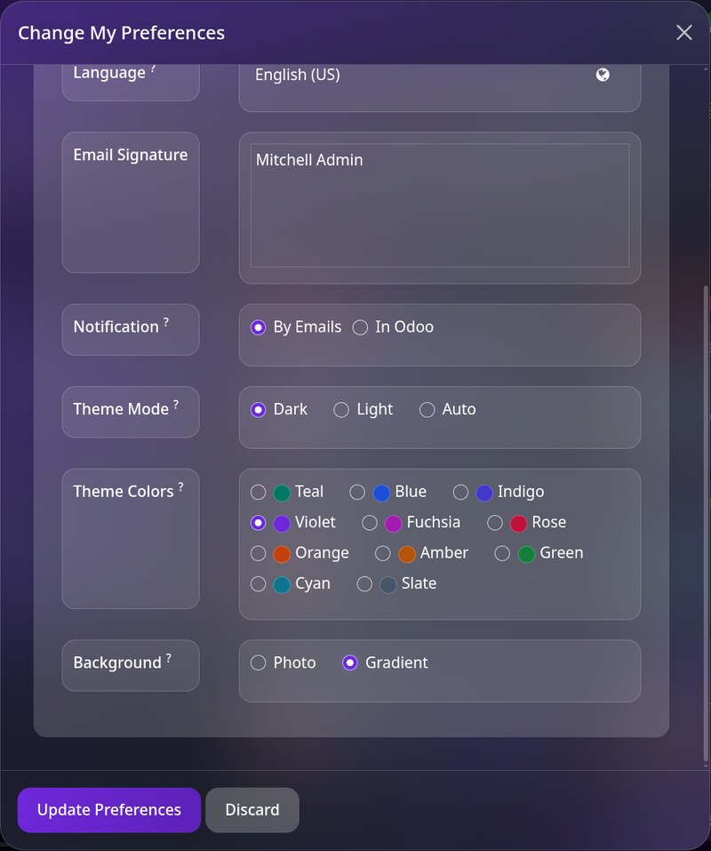

# Liquid Glass Backend Theme

A glassmorphism backend theme for Odoo 19 (Community and Enterprise), with per-user color schemes and a per-user light, dark or automatic mode.

> **Derived work.** This theme is derived from the *Liquid Glass Backend Theme* by
> [Cybrosys Techno Solutions](https://www.cybrosys.com) (© 2026 Cybrosys Technologies Pvt. Ltd., LGPL-3).
> All original rights stay with Cybrosys. Roberto Fichera's changes are listed in
> [`doc/RELEASE_NOTES.md`](doc/RELEASE_NOTES.md) and [`NOTICE`](NOTICE).

## Features

- Glass navbar, control panel, forms, lists, kanban, dialogs and chatter.
- Apps sidebar opened from the ☰ button in the navbar.
- **Light / Dark mode per user**: *My Preferences > Theme Mode*, or *Light Mode* / *Dark Mode* in the user menu. *Auto* follows the operating system.
- **Color schemes per user**: Teal (default), Blue, Indigo, Violet, Fuchsia, Rose, Orange, Amber, Green, Cyan, Slate, in *My Preferences > Theme Colors*, previewed live. The palette colors of every scheme are tested at 4.5:1 or more in both modes.
- **Background per user**: in dark mode, *Photo* (default) or a *Gradient* tinted with the scheme. All three preferences are previewed live.
- **Accessibility**: visible keyboard focus; the apps sidebar is a modal dialog (labelled, unreachable while closed, focus moved in and back, Escape to close, Tab kept inside); readable focused app and search on the Enterprise home menu; reduced-motion support.

## Screenshots

Dark mode (Teal with the *Photo* background, the others with *Gradient*):

Light mode:

The preferences of a user:

## Changes from the Cybrosys original

- Odoo Enterprise: glass home menu background; the sidebar toggle is added to the Enterprise navbar by the bridge module [`backend_theme_liquid_glass_enterprise`](https://github.com/robyf70/backend_theme_liquid_glass_enterprise).
- Renamed from `theme_liquid_glass` to `backend_theme_liquid_glass`: the `website` module hides every `theme_*` module from Apps.
- Colours moved to CSS custom properties, with a light set and a new `res.users.liquid_glass_mode` field.
- Color schemes (`res.users.liquid_glass_scheme`): body class `o_lg_scheme_<name>`, one `$lg-schemes` entry in `variables.scss` per scheme (and one option of the field).
- Theme Mode *Auto*: body class `o_lg_auto`, light through `@media (prefers-color-scheme: light)`.
- Dark mode background (`res.users.liquid_glass_background`): body class `o_lg_gradient`.
- Graph views use the text color of the palette and follow its changes.
- Readable navbar menus and systray icons (they were unreadable in debug mode on Enterprise), command palette, status bar and primary buttons.

## Dependencies

| Module | Source |
|---|---|
| `base`, `web` | Odoo |

On Odoo Enterprise also install [`backend_theme_liquid_glass_enterprise`](https://github.com/robyf70/backend_theme_liquid_glass_enterprise) (it installs automatically when `web_enterprise` is present).

## Installation

Put this directory on the Odoo `addons_path` and install *Liquid Glass Backend Theme* from Apps.

## Configuration

Each user picks *Dark* (default), *Light* or *Auto* in *My Preferences > Theme Mode*, a color scheme in *My Preferences > Theme Colors* and a dark mode background in *My Preferences > Background*.

## License

[LGPL-3](LICENSE) (supplementing the [GPL-3](COPYING)).

## Credits

**Authors**

* Cybrosys Techno Solutions — original theme
* Roberto Fichera — modifications

**Contributors**

* Cybrosys Techno Solutions — odoo@cybrosys.com
* Roberto Fichera — roby.fichera@gmail.com
